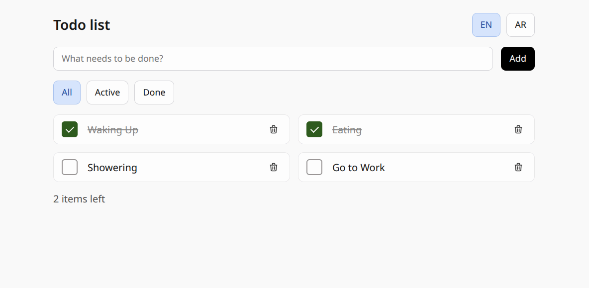
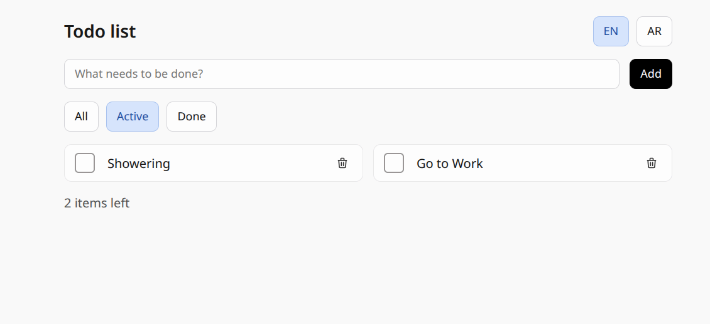
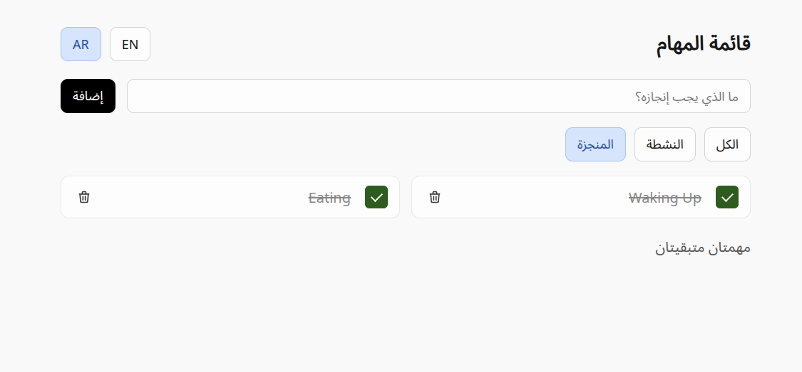
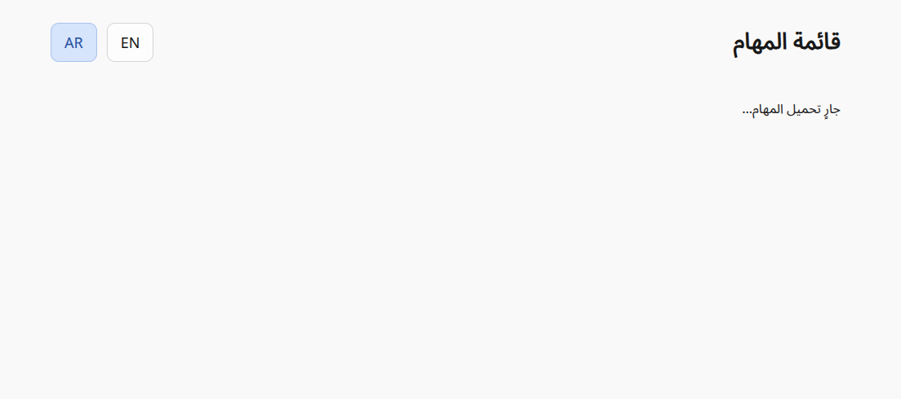
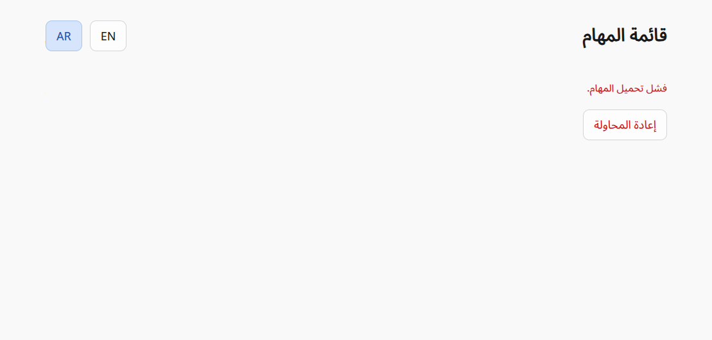
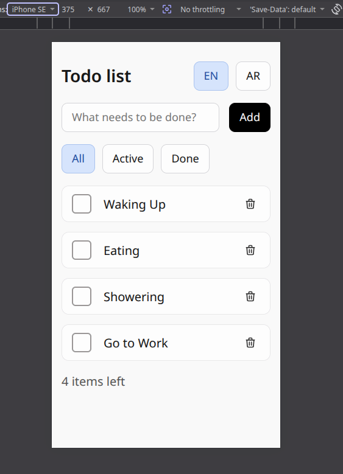

### **Starting Up:**

#### 1. Install dependencies:
`npm install`
#### 2. Run in development:
`npm run dev`

### **Preview:**

#### English
| All | Active filter |
| --- | --- |
|  |  |

#### Arabic (RTL)
| Done filter | Loading | Error |
| --- | --- | --- |
|  |  |  |

#### Mobile (iPhone SE)

